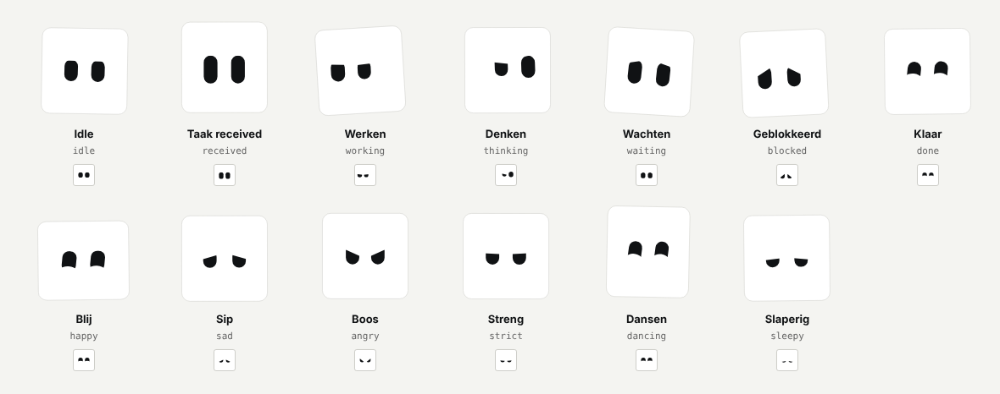

# Dashy

Een levend avatar-figuurtje: een wit lijf met alleen ogen. Geen afhankelijkheden, ongeveer 250 regels simulatie.

## Snel starten

```bash
npm install
npm test        # 34 tests: grenzen, soepelheid, scenario's
npm run build   # dist/dashy.js, types en dist/demo.html (dubbelklikken om te proberen)
```

```ts
import { mountDashy } from 'dashy-avatar';

const dashy = mountDashy(document.getElementById('avatar')!, { shape: 'circle' });
dashy.setState('working');   // idle, received, working, thinking, waiting, blocked, done
dashy.setState('happy');     // happy, sad, angry, strict, dancing, sleepy
dashy.poke();                // schrikken (4x snel = boos)
dashy.destroy();
```

Het element waar je Dashy in zet bepaalt de grootte (vierkant, schaalt mee).

## Hoe het in elkaar zit

- `src/core.ts`: de simulatie. Geen DOM, geen timers. Je geeft de tijd mee via `step(now)` en krijgt geometrie terug (lijf, gezicht, twee ogen). Dit is het deel dat je naar andere platforms overzet.
- `src/svg.ts`: tekent die geometrie als SVG, volgt de muis, respecteert "minder beweging" en zet een leesbare tekst voor schermlezers.
- `tests/sim.test.ts`: dient tegelijk als specificatie. Een Swift- of Kotlin-port is klaar zodra dezelfde scenario's slagen.

Standaard zijn de ogen 34 x 55 (gulden snede). Voor 34 x 66: `createDashy({ eyeScale: 1 })`.

## Aansturen vanuit je app

Jouw app vertaalt gebeurtenissen naar een toestand. Voorbeeld:

| Gebeurtenis | Toestand |
|---|---|
| Nieuwe taak | `received` (gaat zelf door naar `working`) |
| Taak afgevinkt | `done` (valt na enkele seconden terug naar `idle`) |
| Wacht op jouw antwoord | `waiting` |
| Kan niet verder | `blocked` |
| Deadline dichtbij | `strict`, daarna `angry` |
| Uur niks gedaan | `sad` |
| Pauze | `sleepy` |

## Kleine formaten

Op 32 px en kleiner kiest Dashy automatisch een eenvoudiger tekening (`variant: 'auto'`): stilstaand lijf, bredere ogen, dikkere oogleden en een zwaardere rand. Alle beweging komt nog steeds uit `core.ts`. Forceren kan met `variant: 'small'` of `'full'`.

## Statische exports

`npm run export` maakt uit `core.ts` (via Chromium voor de PNG's) alles in `exports/`:

| Map | Inhoud |
|---|---|
| `svg/`, `svg/small/` | SVG per toestand (volle en kleine tekening) |
| `png/` | PNG per toestand, 512 en 128 px, transparant |
| `app-icon/` | 1024 px per toestand zonder transparantie (voor iOS en macOS) en `apple-touch-icon.png` (180 px) |
| `favicon/` | `favicon.svg`, `favicon.ico` (16, 32, 48) en per toestand 16 en 32 px |
| `docs/states.png` | overzicht van alle toestanden |

De achtergrondkleur van de app-iconen staat bovenaan `scripts/export-static.ts` (`ICON_BACKGROUND`). Een test controleert dat de SVG's in `exports/` overeenkomen met wat de generator nu maakt: pas je `core.ts` aan, draai dan `npm run export`.



## Advies van Claude (optioneel)

Claude kiest een toestand en één korte zin in Dashy's karakter op basis van je agenda en taken. Het antwoord is strikt `{ "state": "...", "line": "..." }`.

```ts
import { fetchAdvice, mergeAdvice } from 'dashy-avatar/advice';

const advice = await fetchAdvice({ now: new Date().toISOString(), tasks, agenda }, { url: '/api/dashy-advice', token });
const { state, line } = mergeAdvice(driverResolution, advice);   // de driver wint bij deadlines, blokkades, pauze enz.
```

- **Toegestane toestanden:** `idle, working, thinking, waiting, happy, sad, angry, strict, dancing, sleepy`. Niet `received`, `done` en `blocked`: die komen uit gebeurtenissen van de app.
- **Veilige terugval:** bij elke fout (netwerk, timeout, status, ongeldig of te uitgebreid antwoord, niet-toegestane toestand) is het resultaat `{ state: 'idle', line: '' }`. De client en de server controleren het antwoord allebei opnieuw. Elke serverreactie, ook een fout, heeft precies die vorm.
- **Server:** `api/dashy-advice.ts` (Vercel Function) roept Claude aan met de AI SDK (`claude-opus-5-5`, `effort: low`, strikt JSON-schema). Zie `.env.example` voor de variabelen. Zonder `DASHY_API_TOKEN` of zonder Upstash (rate limit, 20 per uur per adres) doet de route geen modelaanroep.
- **Taken en agenda zijn gegevens, geen instructies:** ze gaan begrensd (40 taken, 20 afspraken, 80 tekens per titel) en schoongemaakt in een `<data>`-blok naar het model.
- **Privacy:** titels en tijden van je taken en afspraken gaan naar Anthropic. Stuur geen details mee die je daar niet wilt hebben.

## Dashy bedienen via Claude (MCP)

Claude roept jouw app aan, niet andersom: een remote MCP-server op Vercel (`api/mcp.ts`, Streamable HTTP, zonder sessies) schrijft naar één document in Upstash Redis. De app haalt de toestand op via `api/dashy-state.ts`.

| Tool | Doet |
|---|---|
| `dashy_task` | `added` (met korte `title`, optionele `due` en `note`), `done` (Dashy viert), `reopen`, `removed`, `due` (deadline wijzigen of wissen). Het resultaat zegt wat er nu "Nu" staat. |
| `dashy_appointment` | `added` (id, titel, start, optioneel einde) of `removed`. Binnen 10 minuten voor de start wordt het "Nu". |
| `dashy_habit` | gewoonte zonder streaks: `added` (titel, `perWeek` 1-7, optioneel als-dan-`plan`), `check` / `uncheck` (vandaag), `removed`. Het scherm toont alleen "x van y deze week". |
| `dashy_focus` | kies welke taak als eerste moet (`id`), of `null` om te wissen. Een deadline binnen 15 minuten gaat altijd voor. |
| `dashy_flag` | `waiting`, `blocked`, `break` (slaperig), `working` aan of uit |
| `dashy_activity` | "er is iets gedaan": houdt Dashy uit `sad` |
| `dashy_mood` | stemming + één zin (max 100 tekens), verloopt na 30 minuten, `clear: true` haalt weg |

**Privacy:** titels en notities staan in jouw eigen Upstash-database (één JSON-document, `dashy:v1`) en op je scherm, nergens anders. Zet er geen geheimen in. Afgeronde taken verdwijnen na 24 uur, afspraken 12 uur na afloop.

De prioriteiten van de driver blijven gelden: Claudes stemming verschijnt alleen als Dashy niets urgents heeft (geen deadline, blokkade, wachten, pauze of viering). Elk toolresultaat zegt wat Dashy nu toont en waarom, ook als de stemming wordt verborgen.

```bash
# Claude Code
claude mcp add --transport http dashy https://<jouw-app>.vercel.app/api/mcp --header "Authorization: Bearer <DASHY_MCP_TOKEN>"
```

Het scherm koppelen (één keer per apparaat): open de app met `https://<jouw-app>.vercel.app/#key=<DASHY_STATE_TOKEN>&act=<DASHY_ACTION_TOKEN>`. Beide tokens blijven in `localStorage` van dat apparaat, de adresbalk wordt direct schoongemaakt en er staat niets geheims in de publieke bundel. Zonder `act` kan het scherm taken laten zien maar niet afvinken. Het blok **Nu** toont dan het ene ding dat nu aan de beurt is, met een knop **Klaar** (via `/api/dashy-action`).

- **Drie geheimen:** `DASHY_MCP_TOKEN` (Claude, schrijven), `DASHY_STATE_TOKEN` (scherm, alleen lezen) en `DASHY_ACTION_TOKEN` (scherm, alleen taken afvinken of terugzetten). Elk werkt alleen op het eigen eindpunt. Het MCP-token kan ook als `?key=` in de URL, voor connectors zonder headers. URL's komen in logs, dus gebruik de header waar het kan.
- **Zonder Redis of token** doet niets iets: de eindpunten geven 503 en een rustige Dashy.
- **Twee schrijfacties binnen enkele milliseconden** kunnen elkaar overschrijven (laatste wint). Voor één persoon met één Claude is dat acceptabel.

## Buddy-functies (onderzoeksgedreven)

Zie `docs/RESEARCH.md` voor onderzoek, bronnen en wat het bewijs wel en niet zegt.

- **Begin (10 min):** korte sessie op de taak in "Nu", met zichtbare tijd; Dashy werkt mee. Aan het eind: "klaar, of nog 10 minuten?" (nooit een verwijt).
- **Gewoontes** zonder streaks, met als-dan-plan, in het blok Planning. Afvinken kan op het scherm (met het actie-token), Claude zet ze op.
- **Snel toevoegen** in Planning (alleen een titel; Claude kan er later een tijd aan hangen).
- **Even stoppen** (knop bij Dashy): 10 minuten uitstel, ademcirkel, een andere activiteit. Geen vragen, geen teller. Hoe het afliep blijft alleen op het apparaat. Geen medische hulp.
- Het actie-eindpunt kan alleen: taak afvinken/terugzetten, taak toevoegen (titel), taak kiezen, gewoonte van vandaag afvinken. Niets anders.

## Spotify-blok

`<NowPlayingBlock />`: de albumhoes met een vinylplaat die eruit schuift en draait (33⅓ toeren) zolang er muziek speelt. Dashy danst ernaast. Pauzeert de muziek, dan stopt de plaat en wordt Dashy weer rustig.

```tsx
import { NowPlayingBlock, useSpotify } from 'dashy-avatar/react';

const sp = useSpotify({ clientId: SPOTIFY_CLIENT_ID, redirectUri: 'https://jouw-app.example/callback' });
<NowPlayingBlock {...sp} onConnect={sp.connect} onDisconnect={sp.disconnect} driver={driverResolution} spotifyLogoSrc="/spotify-logo.svg" />
```

**Wat jij moet regelen (kan ik niet voor je doen):**
1. Maak een app aan op <https://developer.spotify.com/dashboard> en zet de redirect-URL erin. Alleen `https://...` of `http://127.0.0.1:POORT/...`, **niet** `localhost`.
2. Een nieuwe app staat in ontwikkelmodus: maximaal **5 gebruikers**, die je onder User Management op de lijst zet, en de eigenaar moet **Spotify Premium** hebben. Anders krijg je 403 en toont het blok een uitleg.
3. Download het **officiële Spotify-logo** (volledig logo, minstens 70 px breed) uit Spotify's design guidelines en geef het mee als `spotifyLogoSrc`. Spotify eist het logo bij hoes en titels. Ik teken het niet zelf na.

- **Inloggen:** Authorization Code met PKCE, zonder geheim in de app. De tokens staan in `localStorage`; de gegevens die Spotify teruggeeft (titel, artiest, hoes) worden alleen getoond.
- **Hoes:** onaangeroerd (niet bijgesneden, niets erover, niet geanimeerd), met 4 px afgeronde hoeken (8 px vanaf 300 px) en de link "LISTEN ON SPOTIFY". Het vinyl kleurt per album uit een vast palet en gebruikt de hoes nooit voor het label.
- **Dashy danst alleen** als de driver niets urgents heeft (`idle`, `quiet`, `working`). Een deadline, blokkade, pauze of viering blijft zoals de driver zegt.
- **Tempo:** Dashy danst in zijn eigen tempo uit `core.ts`, niet op het ritme van het nummer.
- **Verminder beweging:** de plaat blijft stil. Het polling staat stil als het venster verborgen is.

## Het scherm: losse blokken (`npm run dev`)

Een rustig bento-scherm met vijf blokken: **Dashy**, **Straks**, **Planning**, **Muziek** en **Vandaag**. Zolang alles rustig is, staat elk blok op zijn plek. Heeft iets aandacht nodig, dan groeit dat blok soepel tot ongeveer het halve scherm en worden de andere kleiner maar leesbaar.

| Wat | Dan groeit |
|---|---|
| Deadline binnen 15 minuten | Dashy (hij wordt boos) |
| Afspraak binnen 10 minuten | Straks |
| Dashy zit vast of wacht op jou | Dashy |
| Deadline binnen een uur | Planning |
| Taak afgevinkt | Dashy, 4 seconden |
| Er begint muziek | Muziek, 8 seconden |

- **Zelf vergroten:** elk blok heeft een knop. Een tik vergroot het 10 minuten, nog een tik of Escape laat los. Wat jij kiest wint altijd.
- **Niet flapperen:** een minder belangrijke verandering wacht tot het huidige blok minstens 10 seconden groot is geweest.
- **Soepel:** alleen de kolom- en rijmaten van het grid veranderen; de browser animeert dat, en de inhoud van de blokken past zich aan. Bij "verminder beweging" springt het direct.
- **Staand en liggend** (telefoon aan de lader, tablet, desktop) hebben elk hun eigen indeling met dezelfde regels.
- **Dashy leeft op de pagina:** hij heeft geen kaart achter zich. Zijn witte lichaam is het blok, een vierkantje met lucht erboven en ernaast en een vloer eronder. Het lijf ademt, stuitert, wordt platgedrukt en kantelt zoals `core.ts` dat berekent, en de schaduw op de vloer krimpt als hij omhoog gaat. Hij kijkt naar het blok dat aandacht nodig heeft. Een tik op zijn lijf laat hem schrikken, een tik ernaast laat zijn blok groeien. Het lichaam blijft **gegarandeerd binnen zijn eigen open ruimte** (dat is rekenkundig bewezen en in een echte browser gemeten), dus hij komt nooit over of achter een ander blok.
- **Stijl:** vlak en kaal. Geen schaduwen, randen of kopjes: een blok legt zichzelf uit en het hele blok is aanraakbaar (de knop voor toetsenbord en schermlezer verschijnt bij focus). Aandacht is een klein accentpuntje en het groeien zelf. Lettertype **Geist** (zelf gehost via `@fontsource-variable/geist`, dus geen verzoek aan Google), zeer lichte cijfers met strakke spatiëring, warme steengrijze tinten voor licht, grafiet voor donker, één warm accent (vermiljoen) voor urgentie en één saliegroen voor klaar.
- **Demo:** rechtsonder staat een knop "Demo" om elke situatie meteen te proberen. Met `VITE_SPOTIFY_CLIENT_ID` (zie `.env.example`) gebruikt het blok echte Spotify; na het koppelen via de link (zie MCP) stuurt Claude Dashy en de lijsten aan en verdwijnt het demo-paneel.

## Andere platforms

| Platform | Aanpak |
|---|---|
| Web | `mountDashy` zoals hierboven (of zet `core.ts` achter je eigen React-component). |
| Desktop / Mac (Electron, Tauri) | Zelfde webcode. |
| iPhone / native Mac | Eerste versie: web-view met dezelfde code. Daarna: SwiftUI `Canvas` plus een Swift-port van `core.ts`. De tests zijn de specificatie. |

## Bekende grenzen

- Getest op berekening en stilstaande beelden. Het live gevoel op echte apparaten (60 en 120 Hz, mobiel) moet nog met de hand beoordeeld worden.
- In heel kleine formaten (rond 24 px) zijn de details van oogleden niet meer zichtbaar. Daarvoor is een vereenvoudigde variant nodig.
- De stijl ligt bewust dicht bij Dots, Grokbot en MausBot. Geef Dashy een eigen kleur of eigenaardigheid voor je lanceert.
